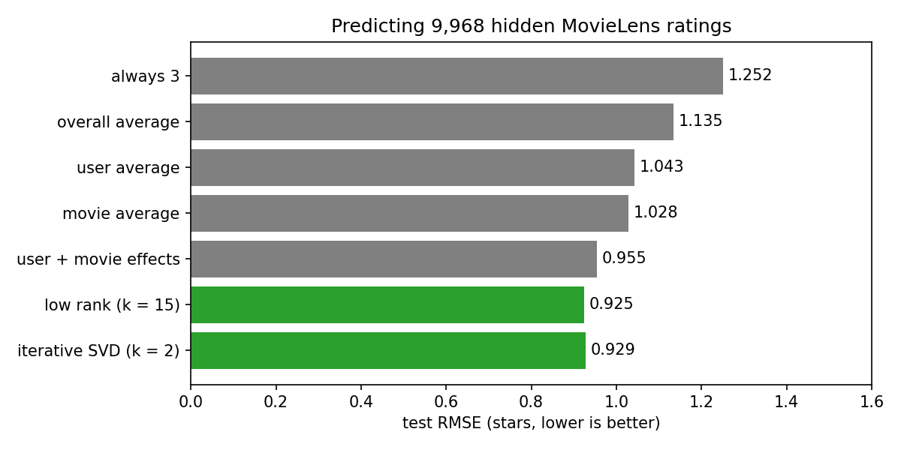
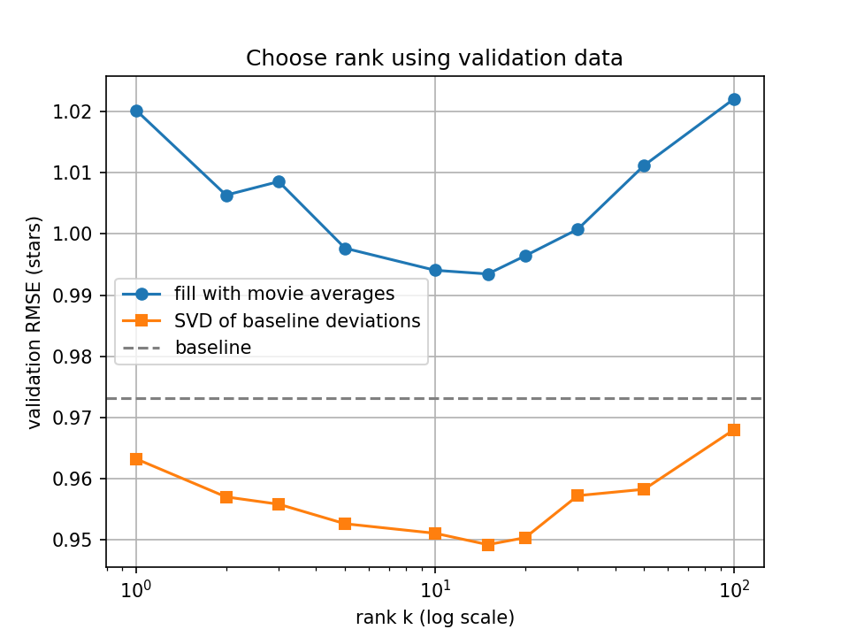

# Predicting Movie Ratings with Low-Rank Matrices

**Our two SVD models predict 9,968 hidden MovieLens ratings to within about 0.93 stars (test RMSE 0.9250 and 0.9286), about 3% better than the best simple average (0.9545), and without being told any genres the SVD discovered a "sci-fi and action vs. musicals and family movies" taste factor.**

## The question
Can you predict what someone will like from what everyone else likes? We wanted to see how far plain linear algebra gets on a real version of this problem: 943 people rated some of 1,682 movies, and we try to guess the ratings they never gave.

## The idea
Put the ratings in a matrix: one row per user, one column per movie. 94% of it is empty. If tastes depend on a few hidden factors, the full matrix should be close to low rank. We predict the baseline (average + user effect + movie effect), then let the SVD fill in the personal part with its best rank-k approximation. We hid 10% of the ratings as a test set and never used them to build any model.

## Results
1. **Low rank beats averages, but only with the baseline subtracted.** Filling the gaps with movie averages and taking the SVD never beat the baseline on validation (best 0.9934 vs 0.9731), but the SVD of the deviations from the baseline beat it at every rank and got a test RMSE of 0.9250 at k = 15, vs 0.9545 for the baseline.

   

2. **What it learned.** Without being told any genres, the model found patterns like "sci-fi and action vs. musicals and family movies" on its own, and from just 14 ratings by a new user it moved edgy cult movies like *A Clockwork Orange* and *GoodFellas* up and big 1996–97 blockbusters like *Air Force One* down, but only by a quarter of a star at most, so all 10 of its top picks were the same crowd favorites that the simple average recommends.

## Limitations
- With only 14 ratings, a new user mostly gets the same crowd favorites as everyone else: all 10 of the model's top picks for our new user were also in the baseline's top 10 (notebook 04).
- A brand-new user with no ratings at all gets the exact same list as everyone, and movies with only 1 or 2 ratings can end up at the top of it (*A Great Day in Harlem* scores 5.43 from a single rating, notebook 03).
- The SVD's gain over the baseline is small (about 0.03 stars), and the two SVD models are only 0.0036 stars apart on the test set, which is less than scores can move just from picking a different random test set (0.003 to 0.02 stars, notebook 02, Exercise 3), so the two are basically tied.
- RMSE only measures how close the predicted stars are on average. It doesn't check whether the top recommendations are movies someone would actually want to watch.
- The data is small and old: 943 users and 1,682 movies from 1997–98, so it's a lot smaller than a real streaming service.

## How to run it
Open any notebook in `notebooks/`, click "Open in Colab", then Runtime -> Run all (and "Run anyway" if Colab warns that the notebook is from GitHub). Each notebook downloads the data itself. Our functions are in `src/evaluate.py` and `src/models.py`.

| Notebook | What it shows |
|---|---|
| [01_ratings_matrix](notebooks/01_ratings_matrix.ipynb)  | The ratings as a 943 × 1682 user-by-movie matrix, and why a low-rank model makes sense |
| [02_baselines](notebooks/02_baselines.ipynb)  | An honest train/test split and five simple baselines (best: user + movie effects, 0.9545) |
| [03_low_rank](notebooks/03_low_rank.ipynb)  | Three SVD models, choosing k with a validation set, and the final test scores |
| [04_what_it_learned](notebooks/04_what_it_learned.ipynb)  | Naming the hidden factors, and recommendations for a new user |
| [05_hero_figure](notebooks/05_hero_figure.ipynb)  | The chart at the top of this page |

## Data and references
- MovieLens 100K, GroupLens Research (https://grouplens.org/datasets/movielens/100k/). Not included here, as required by its license.
- F. M. Harper and J. A. Konstan (2015), The MovieLens Datasets: History and Context, ACM TiiS 5(4).
- C. Eckart and G. Young (1936), The approximation of one matrix by another of lower rank, Psychometrika 1, 211-218.

## Use of AI tools
I used Claude (Anthropic's AI assistant, through Claude Code) for most of the hands-on work. For each milestone, it turned the handout into a Colab notebook: it typed in the handout's code, wrote the code for the exercises, drafted the explanations under each cell and the exercise answers, and ran every notebook from a fresh start to check that it works. When I asked it to, it also picked the 14 example movie ratings in notebook 04. It moved the shared functions into `src/`, made the hero figure notebook, and drafted this README. I chose the project, told it what to do at each step, and made all the commits myself.

## About
Alok Patel, MATH 344L, University of South Carolina, Fall 2026. The code is released under the [MIT License](LICENSE).
